<div align="center">

# 🛰️ incident-sense

**An ITSM workspace with an AI that shows its work: it grades change requests before the deploy, suggests _grounded_ resolutions after it and surfaces the _failures that repeat_, over a fictional bank's incidents.**

[](https://github.com/johnlaff/incident-sense/actions/workflows/backend-ci.yml)
[](https://github.com/johnlaff/incident-sense/actions/workflows/frontend-ci.yml)
[](LICENSE)

`Python 3.12` · `FastAPI` · `LlamaIndex` · `Qdrant` · `BERTopic` &nbsp;|&nbsp; `Next.js 16` · `React 19` · `TypeScript` · `Tailwind v4`

<sub>🌐 <a href="README.md">Português</a> · <b>English</b></sub>

**Live demo:** [incident-sense.joaoaraxaiba.workers.dev](https://incident-sense.joaoaraxaiba.workers.dev) · **API:** [incident-sense-api.onrender.com](https://incident-sense-api.onrender.com/api/health)

</div>

---

incident-sense is a live demo, built for presentations and classes. It
reproduces, on synthetic data, two references on AI in a bank's IT operations:

- **Before the deploy** (Freitas Neto, 2026): an AI judge grades a change
  request field by field and checks that the parts tell the same story.
- **After the deploy** (Ferreira, 2026): for each incident, the AI finds
  similar resolved cases, decides whether the ticket is a real incident and
  suggests a resolution that cites its sources.

When a large bank has an IT problem (Pix going down, the app rejecting logins,
boletos failing), the on-call analyst asks two questions:

1. **Have we solved this before? How?** The answer is in some old, similar
   ticket, buried among thousands.
2. **Does this keep happening?** Several similar incidents may be the **same**
   underlying problem, and nobody notices in the volume.

incident-sense answers both in an ITSM-style interface, with an AI that
**shows every step** instead of asking for blind trust. A person always
decides.

> [!NOTE]
> Everything runs on **synthetic** data for a **fictional** bank ("Banco
> Meridiano"). No real data, no real company: this is a _clean-room_ project.
> The UI is in Brazilian Portuguese; screen names below are given in Portuguese
> with a translation.

## ✨ What it does

| Screen | Where | What it shows |
| --- | --- | --- |
| **Incidentes** (Incidents) | `/incidentes` | All 431 incidents, with filters in the URL and pagination. On the detail page, the **Análise da IA** (AI analysis) tab replays the seven pipeline steps with what each one decided, and the **Notas de trabalho** (work notes) receive the published suggestion. |
| **Perguntar à IA** (Ask the AI) | button on the incident | The **AI assistant**. The first question runs the full analysis (`POST /api/suggest`); later ones go to `POST /api/incidents/{n}/ask`, which answers from the incident and the cases the analysis kept only, cites them and never publishes a note. |
| **Repetições** (Repeats) | `/recorrencias` (or `/repeticoes`) | "Failures that repeat": the map of the 431 incidents forms groups in five steps (9 groups and 78 isolated cases), with a ranking, service and month filters and each group's Problems. |
| **Problemas** (Problems) | `/problemas` | The 10 Problems (PRB) with root cause, workaround, permanent fix and linked incidents. Every PRB mention opens a preview. |
| **Mudanças** (Changes) | `/changes` | 18 synthetic Changes. The AI judge grades each of the 7 fields from 0 to 10 against a versioned rubric and, with an average of 8.0 or more, checks the coherence across the parts. The verdict comes ready from the backend in the `decision` field. A field that did not change reuses its grade (content lock); **"Avaliar de novo, sem reaproveitar"** (evaluate again, no reuse) sends everything back to the model. |
| **Como a IA funciona** (How the AI works) | `/como-funciona` | The end-to-end process in seven animated chapters, from the Change grade to the Problem that closes the loop. |
| **Modo aula** (Lesson mode) | `?aula=1`, the "Modo aula" button, or `/aula` | Every screen advances step by step, with captions, by tap, arrow keys or a slide clicker. `/aula` holds the demo script. |

## 🎬 Screens

**AI analysis on an incident:** the answer comes first, with the known error, numbered steps and clickable sources.

<div align="center"></div>

**AI assistant ("Perguntar à IA"):** the suggestion with its sources and, below it, a follow-up question.

<div align="center"></div>

**Changes:** a grade per field, the weighted average and the two questions that decide whether the Change goes on.

<div align="center"></div>

**Repeats:** groups of similar incidents and isolated cases.

<div align="center"></div>

**How the AI works:** the 30-second summary and the seven chapters.

<div align="center"></div>

> The screenshots were taken on the published site without triggering AI
> calls: the evaluation is the repository's sample (`frontend/tests/evaluation-fixture.json`)
> and the suggestion is a real API response recorded earlier and replayed in
> the browser.

## 🚀 Start with one command

**Prerequisite:** Docker.

```bash
git clone https://github.com/johnlaff/incident-sense.git
cd incident-sense
cp .env.example .env      # add your OpenRouter key
docker compose up         # open http://localhost:3000
```

The dataset, the vectors and the clustering result are **committed**, so
browsing, Problems and Repeats work immediately, offline. Only the incident
analysis, the assistant's follow-ups and the Change evaluation call the AI live
(a few cents).

> [!TIP]
> Without the key in `.env`, all browsing works; the AI routes answer with a
> clear message (503) asking for the key.

Without Docker: `make setup`, then `make api` and `make web` in two terminals.
With `QDRANT_URL=:memory:` in `.env`, Qdrant runs inside the API and no server
is needed. See [CONTRIBUTING.md](CONTRIBUTING.md).

## 🌐 Publish for free

The public demo runs on two free services. A single OpenRouter key covers chat
and embeddings, and Qdrant runs in memory inside the API, seeded from the
committed vectors.

1. **API on Render (Free plan).** [](https://render.com/deploy?repo=https://github.com/johnlaff/incident-sense)
   creates the service from [`render.yaml`](render.yaml). The only field to
   fill in is `OPENROUTER_API_KEY`.
2. **Continuous API deploy.** Store the service's deploy hook as the
   `RENDER_DEPLOY_HOOK_URL` secret. The
   [`backend-deploy`](.github/workflows/backend-deploy.yml) workflow calls the
   hook on every push to `main` that touches `backend/` or `render.yaml`.
   Without the secret, the deploy step is skipped. To keep the free instance
   awake, the [`keep-awake/`](keep-awake/) Worker pings `/api/health` every 10
   minutes from a Cloudflare cron trigger, published by the
   [`keep-awake-deploy`](.github/workflows/keep-awake-deploy.yml) workflow with
   the same Cloudflare secrets as step 3. GitHub Actions schedules are not used
   for this, because they run hours apart.
3. **Site on Cloudflare Workers (OpenNext).** Add the `CLOUDFLARE_API_TOKEN`
   and `CLOUDFLARE_ACCOUNT_ID` secrets and the `NEXT_PUBLIC_API_URL` variable
   with the API URL. The [`frontend-deploy`](.github/workflows/frontend-deploy.yml)
   workflow publishes on every push to `main` that touches `frontend/`. From
   your machine: `cd frontend && npm run cf:deploy`.
4. Set `FRONTEND_ORIGIN` on Render to the site URL (comma-separated list).

Routes that call models are limited per visitor (`X-Client-Id`), per network
and by a daily cap (`AI_MAX_PER_CLIENT`, `AI_MAX_PER_IP`, `AI_MAX_PER_DAY`), so
a whole audience can use the demo without runaway cost. The network is the
address the proxy appended to `X-Forwarded-For` (`TRUSTED_PROXY_HOPS`, default
1), never the one the client wrote. Every text sent to a model has a maximum
size (description up to 4000 characters, Change field up to 6000, question up
to 600) and bodies over 64 KB get 413. Each provider call gives up after 20 s
with no retry, and the site gives up after 90 s with a message in Portuguese.
Also set a spending limit on the OpenRouter key: it is the financial ceiling
outside the code. Details in [SECURITY.md](SECURITY.md).

## 🧠 How it works

### Incidents: seven steps and one decision

RAG (_Retrieval-Augmented Generation_) means the AI does not invent the answer:
it first **retrieves** similar real cases and only then **writes** the
suggestion from them. `POST /api/suggest` follows Ferreira (2026) step by step:

1. **Load** the incident (category, subcategory, company and tags).
2. **Summarize** with AI: the summary, never the raw text, is the query.
3. **Turn into numbers:** embedding of the summary plus category, subcategory
   and company (`text-embedding-3-large`, 3072 dimensions).
4. **Search and check** in three layers: semantic tags (where to look), vector
   with a 0.8 cosine floor and top-K 5 incidents and 10 Problems (what looks
   alike) and an LLM post-filter that reads each case's title, description and
   resolution (what actually helps). If the post-filter fails, the original
   list comes back.
5. **Context** with what passed, then the **procedência gate**: an
   *improcedente* ticket (self-service, password) or a real incident with no
   context gets no suggestion.
6. **Suggest** with sources: every cited `[INC…]` and `[PRB…]` is checked
   against the context; anything outside it is removed or flagged.
7. **Publish** the suggestion on the incident's work notes, visible only to the
   visitor who asked for the analysis.

Details (PT-BR) in [docs/rag-flow.md](docs/rag-flow.md).

### Changes: an AI judge with a single verdict

`POST /api/changes/{number}/evaluate` grades each field in its own prompt, in
parallel, computes the average weighted by the rubric (weights sum to 13.5)
and, from 8.0 up, checks coherence across the parts and the backout plan
against the tasks. The backend returns `decision` (`passes`, `reason_code`,
`failed`, `reason`): the Change may go on when both the average and the
coherence reach 8.0, there is no real contradiction and the backout plan is not
`NAO_ADERENTE`. Every screen reads only this field. Details (PT-BR) in
[docs/architecture.md](docs/architecture.md#3-avaliação-de-mudanças).

### Repeats: clustering

The same vectors that measure similarity also reveal groups. HDBSCAN clusters
the normalized embeddings, whatever has no dense neighborhood stays an isolated
case, an LLM names each group and a 2D UMAP only draws the map. The result is
precomputed and versioned. Details (PT-BR) in
[docs/clustering-flow.md](docs/clustering-flow.md).

## 🏗️ Architecture

<div align="center">
  
</div>

| Layer | Stack |
| --- | --- |
| **Frontend** | Next.js 16 (App Router) · React 19 · strict TypeScript · Tailwind v4 · Motion · react-markdown · regl-scatterplot |
| **Backend** | Python 3.12 · FastAPI · LlamaIndex · Pydantic v2 · structlog |
| **AI** | OpenRouter with one key: `openai/text-embedding-3-large` (embeddings) and Claude Haiku 5.5 (default), GPT-6 Luna, Gemini 3.8 Flash, DeepSeek V4.1 Flash and Qwen 3.7 Flash (chat, switchable in the model picker) |
| **Data** | Qdrant (in memory in the demo, a server in Docker Compose) · BERTopic + HDBSCAN + UMAP (offline clustering) |
| **Infra** | Render Free (API) · Cloudflare Workers via OpenNext (site) · GitHub Actions (CI, deploy, ping, release to GHCR) · Docker Compose |

## 📁 Layout

```text
incident-sense/
├── backend/      # FastAPI: incidents, ask, Changes, Problems, served clustering
│   ├── src/incident_sense/   # api, rag, changes, data, models, guard
│   └── data/                 # incidents, problems, changes, vectors and clusters (committed)
├── frontend/     # Next.js: incidents, assistant, Repeats, Changes, How the AI works, lesson
│   ├── app/                  # routes
│   ├── components/           # shell, concepts, assistant, lesson mode
│   └── lib/                  # typed API client and view models
├── contracts/    # streaming contract fixtures read by both sides
└── docs/         # architecture, flows, diagrams and ADRs (PT-BR)
```

## 🛠️ Development

```bash
make setup    # install backend (uv) and frontend (npm)
make check    # lint + typecheck + tests (backend and frontend)
make up       # start the full stack with Docker Compose
```

See [CONTRIBUTING.md](CONTRIBUTING.md) (PT-BR) for every command.

## 📚 Go deeper (PT-BR)

- [docs/architecture.md](docs/architecture.md): overview, routes, hosting and Change evaluation
- [docs/rag-flow.md](docs/rag-flow.md): the incident pipeline and the assistant's follow-ups
- [docs/clustering-flow.md](docs/clustering-flow.md): Repeats
- [docs/data-generation.md](docs/data-generation.md): how the synthetic data is generated
- [docs/decisions/](docs/decisions/): ADRs
- [CHANGELOG.md](CHANGELOG.md): what changed in each version

## 📖 References

- FERREIRA, João Lucas Assunção Fonseca. _Sugestão de resolução de incidentes
  com IA_ (Suggesting incident resolutions with AI). Oct. 2026.
- FREITAS NETO, Solange Brasileiro de. _Como um LLM avalia texto escrito por
  humano_ (How an LLM grades human-written text). Oct. 2026.

## 📄 License

Code under the [**MIT**](LICENSE) license. The data is **synthetic and
fictional**: no real information is used or distributed.
