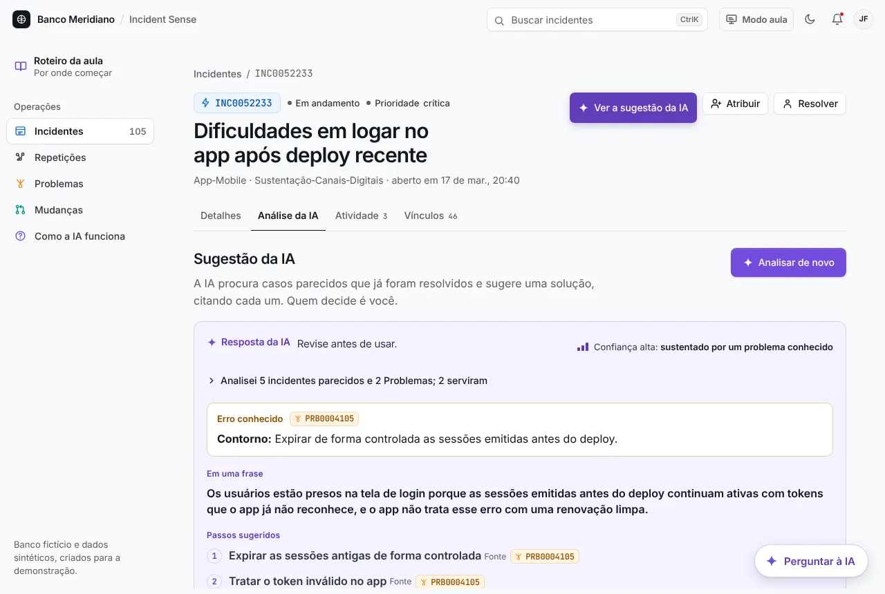
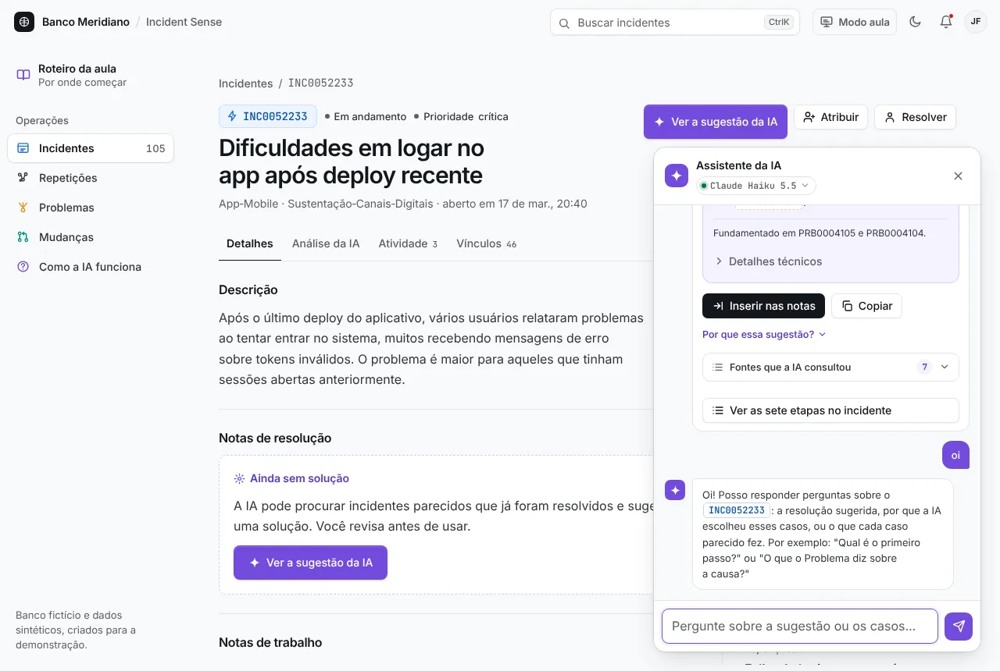
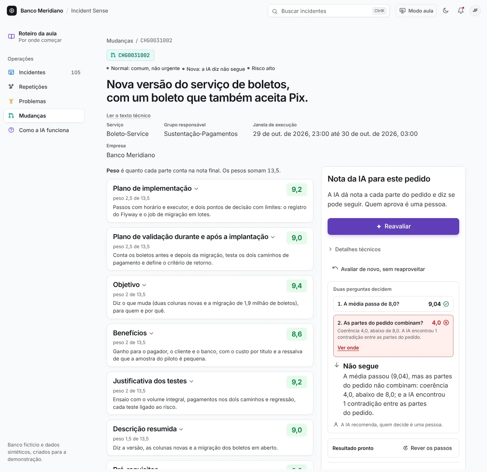
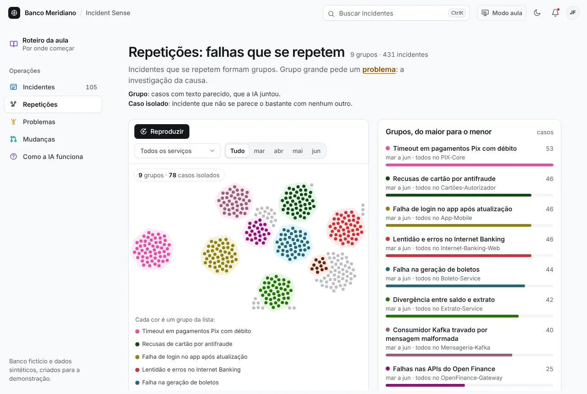
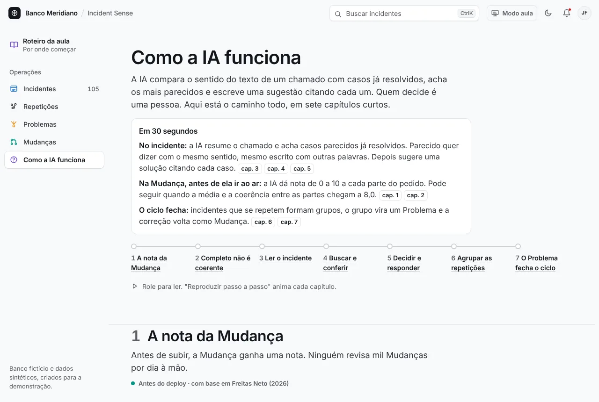

<div align="center">

# 🛰️ incident-sense

**Estação de trabalho ITSM com uma IA que mostra o trabalho: dá nota aos pedidos de mudança antes do deploy, sugere resoluções _fundamentadas_ depois dele e revela as _falhas que se repetem_, sobre os incidentes de um banco fictício.**

[](https://github.com/johnlaff/incident-sense/actions/workflows/backend-ci.yml)
[](https://github.com/johnlaff/incident-sense/actions/workflows/frontend-ci.yml)
[](LICENSE)

`Python 3.12` · `FastAPI` · `LlamaIndex` · `Qdrant` · `BERTopic` &nbsp;|&nbsp; `Next.js 16` · `React 19` · `TypeScript` · `Tailwind v4`

<sub>🌐 <b>Português</b> · <a href="README.en.md">English</a></sub>

**Demo ao vivo:** [incident-sense.joaoaraxaiba.workers.dev](https://incident-sense.joaoaraxaiba.workers.dev) · **API:** [incident-sense-api.onrender.com](https://incident-sense-api.onrender.com/api/health)

</div>

---

O incident-sense é uma demonstração ao vivo, feita para apresentações e aulas.
Ele reproduz, com dados sintéticos, duas referências sobre IA na operação de TI
de um banco:

- **Antes do deploy** (Freitas Neto, 2026): uma IA juíza dá nota ao pedido de
  mudança (Change) campo a campo e confere se as partes contam a mesma história.
- **Depois do deploy** (Ferreira, 2026): para cada incidente, a IA busca casos
  parecidos já resolvidos, decide se o chamado é procedente e sugere uma
  resolução citando as fontes.

Quando um banco grande tem um problema de TI (o Pix parando, o app recusando
login, o boleto não saindo), o analista de plantão se faz duas perguntas:

1. **Já resolvemos isso antes? Como?** A resposta está num chamado antigo
   parecido, perdido em meio a milhares.
2. **Isso está se repetindo?** Vários incidentes parecidos podem ser o
   **mesmo** problema de fundo, e ninguém percebe no meio do volume.

O incident-sense responde as duas numa interface no estilo de um ITSM, com uma
IA que **mostra cada etapa** em vez de pedir confiança cega. Quem decide é
sempre uma pessoa.

> [!NOTE]
> Tudo roda sobre dados **sintéticos** de um banco **fictício** ("Banco
> Meridiano"). Nenhum dado real, nenhuma empresa real: é um projeto
> _clean-room_.

## ✨ O que ele faz

| Tela | Onde | O que mostra |
| --- | --- | --- |
| **Incidentes** | `/incidentes` | Os 431 incidentes, com filtros na URL e paginação. No detalhe, a aba **Análise da IA** repassa as sete etapas do pipeline com o que cada uma decidiu, e as **Notas de trabalho** recebem a sugestão publicada. |
| **Perguntar à IA** | botão no detalhe do incidente | O **assistente da IA**. A primeira pergunta roda a análise completa (`POST /api/suggest`); as seguintes vão para `POST /api/incidents/{n}/ask`, que responde usando só o incidente e os casos que a análise manteve, cita as fontes e nunca publica nota. |
| **Repetições** | `/recorrencias` (ou `/repeticoes`) | "Falhas que se repetem": o mapa dos 431 incidentes vira grupos em cinco passos (9 grupos e 78 casos isolados), com ranking, filtros por serviço e mês e os Problemas de cada grupo. |
| **Problemas** | `/problemas` | Os 10 Problemas (PRB) com causa raiz, contorno, solução definitiva e incidentes ligados. Toda menção a um PRB abre a prévia. |
| **Mudanças** | `/changes` | 18 Changes sintéticas. A IA juíza dá nota de 0 a 10 a cada um dos 7 campos contra uma grade versionada e, com média a partir de 8,0, confere a coerência entre as partes. O veredito vem pronto do backend no campo `decision`. Campo que não mudou reaproveita a nota (trava de conteúdo); **"Avaliar de novo, sem reaproveitar"** manda tudo de novo ao modelo. |
| **Como a IA funciona** | `/como-funciona` | O processo ponta a ponta em sete capítulos animados, da nota da Mudança ao Problema que fecha o ciclo. |
| **Modo aula** | `?aula=1`, botão "Modo aula" no topo, ou `/aula` | Cada tela avança passo a passo, com legenda, por toque, setas ou passador de slides. `/aula` traz o roteiro da demo. |

## 🎬 Telas

**Análise da IA no incidente:** a resposta vem primeiro, com o Erro conhecido, os passos numerados e as fontes clicáveis.

<div align="center"></div>

**Assistente da IA ("Perguntar à IA"):** a sugestão com as fontes e, abaixo, uma pergunta de acompanhamento.

<div align="center"></div>

**Mudanças:** nota por campo, média ponderada e as duas perguntas que decidem se a Change segue.

<div align="center"></div>

**Repetições:** grupos de incidentes parecidos e casos isolados.

<div align="center"></div>

**Como a IA funciona:** o resumo de 30 segundos e os sete capítulos.

<div align="center"></div>

> As capturas foram feitas no site publicado sem disparar chamadas de IA: a
> avaliação é a de exemplo do repositório (`frontend/tests/evaluation-fixture.json`)
> e a sugestão é uma resposta real da API gravada antes e repassada no navegador.

## 🚀 Comece em um comando

**Pré-requisito:** Docker.

```bash
git clone https://github.com/johnlaff/incident-sense.git
cd incident-sense
cp .env.example .env      # adicione sua chave da OpenRouter
docker compose up         # abra http://localhost:3000
```

O dataset, os vetores e o resultado do agrupamento já vêm **commitados**, então
a navegação, os Problemas e as Repetições funcionam na hora, offline. Só a
análise do incidente, as perguntas ao assistente e a avaliação de Mudanças
chamam a IA ao vivo (custo de centavos).

> [!TIP]
> Sem a chave no `.env`, toda a navegação funciona; as rotas de IA respondem
> com uma mensagem clara (503) pedindo a chave.

Sem Docker: `make setup`, depois `make api` e `make web` em dois terminais. Com
`QDRANT_URL=:memory:` no `.env`, o Qdrant roda dentro da API e não é preciso
subir servidor. Veja [CONTRIBUTING.md](CONTRIBUTING.md).

## 🌐 Publique de graça

A demo pública roda em dois serviços gratuitos. Uma única chave da OpenRouter
cobre chat e embeddings, e o Qdrant roda em memória dentro da API, semeado com
os vetores commitados.

1. **API no Render (plano Free).** [](https://render.com/deploy?repo=https://github.com/johnlaff/incident-sense)
   cria o serviço a partir do [`render.yaml`](render.yaml). O único campo a
   preencher é `OPENROUTER_API_KEY`.
2. **Deploy contínuo da API.** Cadastre o deploy hook do serviço como o segredo
   `RENDER_DEPLOY_HOOK_URL`. O workflow
   [`backend-deploy`](.github/workflows/backend-deploy.yml) chama o hook a cada
   push em `main` que mexe em `backend/` ou no `render.yaml`, e faz um ping em
   `/api/health` a cada 10 minutos para a instância gratuita não dormir. Sem o
   segredo, o passo de deploy é pulado.
3. **Site na Cloudflare Workers (OpenNext).** Cadastre os segredos
   `CLOUDFLARE_API_TOKEN` e `CLOUDFLARE_ACCOUNT_ID` e a variável
   `NEXT_PUBLIC_API_URL` com a URL da API. O workflow
   [`frontend-deploy`](.github/workflows/frontend-deploy.yml) publica a cada
   push em `main` que mexe em `frontend/`. Da sua máquina:
   `cd frontend && npm run cf:deploy`.
4. Ajuste `FRONTEND_ORIGIN` no Render para a URL do site (lista separada por
   vírgula).

As rotas que chamam modelos têm limite por visitante (`X-Client-Id`), por rede
e um teto diário (`AI_MAX_PER_CLIENT`, `AI_MAX_PER_IP`, `AI_MAX_PER_DAY`), para
que uma plateia inteira use a demo sem custo descontrolado. Cada chamada ao
provedor desiste em 20 s, sem nova tentativa, e o site desiste em 90 s com um
aviso em português.

## 🧠 Como funciona

### Incidentes: sete etapas e uma decisão

RAG (_Retrieval-Augmented Generation_) significa que a IA não inventa a
resposta: primeiro **busca** casos reais parecidos e só então **redige** a
sugestão a partir deles. `POST /api/suggest` segue Ferreira (2026) etapa por etapa:

1. **Carregar** o incidente (categoria, subcategoria, empresa e tags).
2. **Resumir** por IA: o resumo, nunca o texto cru, é a consulta.
3. **Transformar em números:** embedding do resumo com categoria, subcategoria
   e empresa (`text-embedding-3-large`, 3072 dimensões).
4. **Buscar e conferir** em três camadas: tags semânticas (onde procurar),
   vetor com cosseno mínimo 0,8 e top-K 5 em incidentes e 10 em Problemas (o
   que parece) e pós-filtro por LLM que lê título, descrição e resolução de cada
   caso (o que serve). Se o pós-filtro falhar, volta a lista original.
5. **Contexto** com o que passou, e a **decisão de procedência**: chamado
   improcedente (autoatendimento, senha) ou procedente sem contexto não gera
   sugestão.
6. **Sugerir** com fontes: cada `[INC…]` e `[PRB…]` citado é conferido contra o
   contexto; o que estiver fora é removido ou sinalizado.
7. **Publicar** a sugestão nas notas de trabalho do incidente, visíveis só para
   o visitante que pediu a análise.

Detalhes em [docs/rag-flow.md](docs/rag-flow.md).

### Mudanças: IA juíza com veredito único

`POST /api/changes/{number}/evaluate` dá nota a cada campo num prompt próprio,
em paralelo, calcula a média ponderada pelos pesos da grade (soma 13,5) e, a
partir de 8,0, confere a coerência entre as partes e o plano de retorno contra
as tarefas. O backend devolve `decision` (`passes`, `reason_code`, `failed`,
`reason`): a Change pode seguir quando a média e a coerência chegam a 8,0, não
há contradição real e o plano de retorno não é `NAO_ADERENTE`. Todas as telas
leem só esse campo. Detalhes em
[docs/architecture.md](docs/architecture.md#3-avaliação-de-mudanças).

### Repetições: agrupamento

Os mesmos vetores que medem semelhança também revelam grupos. O HDBSCAN agrupa
os embeddings normalizados, o que não tem vizinhança densa fica como caso
isolado, um LLM dá nome a cada grupo e o UMAP 2D só desenha o mapa. O resultado
é pré-computado e versionado. Detalhes em
[docs/clustering-flow.md](docs/clustering-flow.md).

## 🏗️ Arquitetura

<div align="center">
  
</div>

| Camada | Stack |
| --- | --- |
| **Frontend** | Next.js 16 (App Router) · React 19 · TypeScript estrito · Tailwind v4 · Motion · react-markdown · regl-scatterplot |
| **Backend** | Python 3.12 · FastAPI · LlamaIndex · Pydantic v2 · structlog |
| **IA** | OpenRouter com uma chave: `openai/text-embedding-3-large` (embeddings) e Claude Haiku 5.5 (padrão), GPT-6 Luna, Gemini 3.8 Flash, DeepSeek V4.1 Flash e Qwen 3.7 Flash (chat, trocáveis no seletor de modelo) |
| **Dados** | Qdrant (em memória na demo, servidor no Docker Compose) · BERTopic + HDBSCAN + UMAP (agrupamento offline) |
| **Infra** | Render Free (API) · Cloudflare Workers via OpenNext (site) · GitHub Actions (CI, deploy, ping, release para o GHCR) · Docker Compose |

## 📁 Estrutura

```text
incident-sense/
├── backend/      # FastAPI: incidentes, ask, Changes, Problemas, agrupamento servido
│   ├── src/incident_sense/   # api, rag, changes, data, models, guard
│   └── data/                 # incidentes, problemas, changes, vetores e clusters (commitados)
├── frontend/     # Next.js: incidentes, assistente, Repetições, Mudanças, Como a IA funciona, aula
│   ├── app/                  # rotas
│   ├── components/           # shell, conceitos, assistente, modo aula
│   └── lib/                  # cliente de API tipado e modelos de tela
├── contracts/    # fixtures do contrato de streaming lidas pelos dois lados
└── docs/         # arquitetura, fluxos, diagramas e ADRs
```

## 🛠️ Desenvolvimento

```bash
make setup    # instala backend (uv) e frontend (npm)
make check    # lint + typecheck + testes (backend e frontend)
make up       # sobe a stack completa via Docker Compose
```

Veja [CONTRIBUTING.md](CONTRIBUTING.md) para todos os comandos.

## 📚 Aprofunde

- [docs/architecture.md](docs/architecture.md): visão geral, rotas, hospedagem e avaliação de Mudanças
- [docs/rag-flow.md](docs/rag-flow.md): o pipeline de incidentes e as perguntas ao assistente
- [docs/clustering-flow.md](docs/clustering-flow.md): as Repetições
- [docs/data-generation.md](docs/data-generation.md): como os dados sintéticos são gerados
- [docs/decisions/](docs/decisions/): ADRs
- [CHANGELOG.md](CHANGELOG.md): o que mudou em cada versão

## 📖 Referências

- FERREIRA, João Lucas Assunção Fonseca. _Sugestão de resolução de incidentes
  com IA_. out. 2026.
- FREITAS NETO, Solange Brasileiro de. _Como um LLM avalia texto escrito por
  humano_. out. 2026.

## 📄 Licença

Código sob a licença [**MIT**](LICENSE). Os dados são **sintéticos e
fictícios**: nenhuma informação real é usada ou distribuída.
