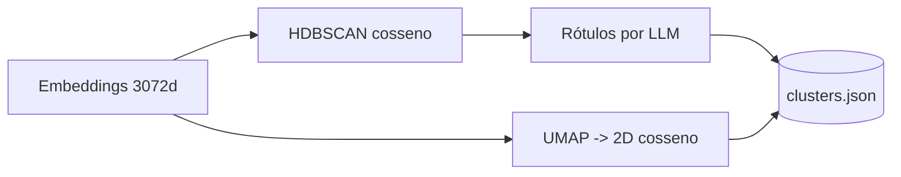

# Fluxo de detecção de recorrência (clustering)

Este é o caminho **offline e determinístico**: agrupar incidentes para revelar
falhas que se repetem, exibidas na tela **Repetições** (`/recorrencias`, também
em `/repeticoes`) como um mapa com rótulos gerados por IA.

O endpoint é `GET /api/clusters`, que serve **verbatim** um resultado
pré-computado e commitado: zero chamadas de API, renderização idêntica sempre.

O resultado atual: 431 incidentes, **9 grupos** e **78 casos isolados**. Os 8
grupos de causa real têm um serviço só cada (o maior é o timeout no Pix, com 53
incidentes); 59 dos 70 incidentes de ruído ficam fora de qualquer grupo.

## A pipeline (BERTopic)

A recomputação (`backend/scripts/precompute.py`) usa o **BERTopic**, que encadeia:



1. **Embeddings** do texto dos incidentes (`text-embedding-3-large` via
   OpenRouter, 3072d), commitados em `embeddings.npz`. A busca do RAG usa outro
   arquivo, com os vetores do resumo (ver [rag-flow.md](rag-flow.md#vetores-da-base)).
2. **HDBSCAN** agrupa os próprios embeddings (normalizados, então a distância
   euclidiana ordena como o cosseno), com `min_cluster_size=8` e
   `min_samples=7`. Pontos em regiões de baixa densidade viram **ruído**
   (`cluster_id = -1`), os _outliers_.
3. **UMAP** reduz para **2D** com métrica **cosseno** e `random_state` fixo, só
   para desenhar o mapa.
4. A **representação OpenAI** do BERTopic gera um **rótulo curto em português**
   para cada cluster (ex.: "Timeout em pagamentos via Pix").

O resultado por incidente: `{ id, x, y, cluster_id, cluster_label, is_outlier,
short_description, priority }`.

## Por que essas escolhas

### Por que cosseno

Como no RAG: embeddings codificam significado pela direção, então a distância
angular agrupa por semelhança semântica melhor que a euclidiana crua.

### O que é o ruído / `-1`

O HDBSCAN não força todo ponto a um cluster. O que não tem vizinhança densa o
suficiente é marcado como **ruído** (`cluster_id = -1`). Na visualização esses
outliers aparecem em **cinza**, como "casos isolados": é o tratamento de ruído
acontecendo à vista.

### Por que não clusterizar em 2D

A primeira versão clusterizava sobre o UMAP 2D. Com `min_dist=0`, o UMAP aperta
incidentes pouco parecidos numa ilha densa, e o HDBSCAN leu os 70 chamados de
ruído (suporte interno: projetor, ramal, ar-condicionado) como um grupo, sem
nenhum caso isolado. Nos embeddings originais esses chamados são esparsos, e o
HDBSCAN deixa a maioria de fora (59 de 70). O UMAP ficou só para o mapa.

## Na tela

A tela Repetições conta o agrupamento em cinco passos sobre um mapa em canvas
com os 431 incidentes: pontos soltos, parecidos se aproximam, densidade forma
grupos, a IA dá nome a cada grupo, e um grupo vira Problema com sua linha do
tempo semanal. Ela abre com o ranking "Falhas que mais se repetem"; tocar num
ponto abre a prévia do incidente e tocar num grupo mostra serviços, motivo,
Problemas ligados e incidentes. Há filtros por serviço e mês. A posição de cada
grupo vem da projeção UMAP real (`app/recorrencias`, testado em
`tests/recorrencias-model.test.ts`), e os passos também rodam no modo aula.

## Determinismo

Seeds fixos no UMAP (e HDBSCAN determinístico) tornam o layout reprodutível. Os
rótulos vêm do LLM e são **congelados** no `clusters.json` commitado, então a
visualização não muda entre execuções nem precisa de chave de API.

## Recomputar

```bash
make precompute        # reembed + reclusteriza + rerotula (precisa de chave)
```

Veja [data-generation.md](data-generation.md) para como o dataset por trás é
gerado.
