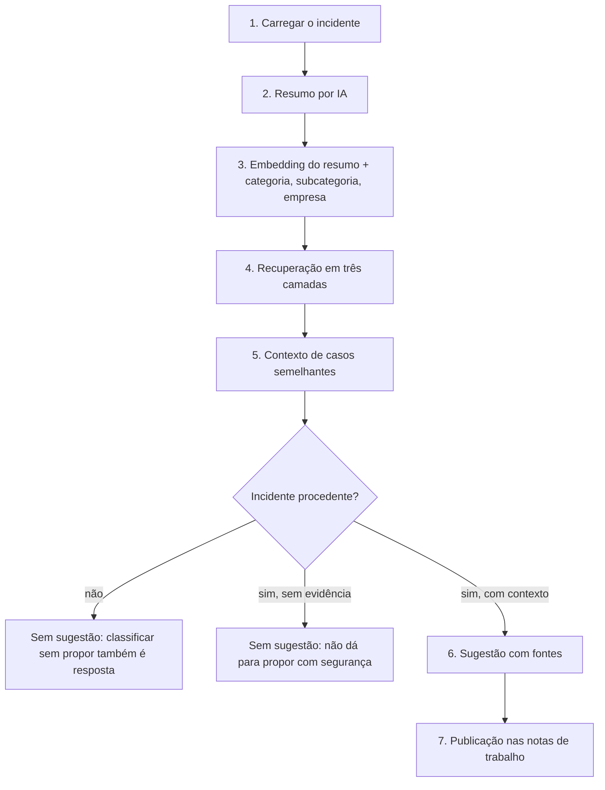

# Fluxo de sugestão (RAG de operação)

Este é o caminho **ao vivo** do demo: dado um incidente, recuperar incidentes
resolvidos e problemas parecidos, decidir se o chamado é procedente e, se for,
sugerir uma resolução com fontes e publicá-la de volta no incidente.

O fluxo reproduz, com dados sintéticos do fictício **Banco Meridiano**, o
pipeline descrito no artigo "Sugestão de resolução de incidentes com IA", de
João Lucas Assunção Fonseca Ferreira (outubro de 2026). Os
parâmetros públicos do artigo (cosseno mínimo 0,8, top-K 5 em incidentes e
top-K 10 em problemas) são os padrões da configuração.

O endpoint é `POST /api/suggest`. Cada etapa é uma função pequena e testável em
`backend/src/incident_sense/rag/pipeline.py`, e a resposta expõe todas elas com o
que cada uma decidiu.

## As sete etapas



1. **Carregar.** Com `number`, o incidente é lido da base (no artigo, do ITSM).
   Categoria, subcategoria, empresa e tags vêm do registro. Sem número, valem os
   campos da requisição e a empresa padrão é `Banco Meridiano`.
2. **Resumo por IA.** O LLM resume o chamado em uma ou duas frases e escolhe tags
   semânticas de um vocabulário fechado. O resumo, e nunca o texto cru, é a
   consulta: a qualidade da sumarização limita todo o pipeline. Se o provedor
   falhar, o título vira a consulta e a etapa aparece como "com contorno".
3. **Embedding.** O texto vetorizado é o resumo concatenado com
   `Categoria`, `Subcategoria` e `Empresa`, com `openai/text-embedding-3-large`
   (3072 dimensões) via OpenRouter. A resposta devolve esse texto em `query_text`,
   o tamanho do vetor em `dims` e os 24 primeiros valores, arredondados em três
   casas, em `embedding_preview` (para a tela mostrar o texto virando números sem
   trafegar o vetor inteiro).
4. **Recuperação em três camadas** (detalhes abaixo).
5. **Contexto.** Incidentes e problemas que passaram pelas três camadas formam o
   contexto (`context_ids`).
   **Decisão de procedência.** O LLM decide se o chamado é um incidente técnico
   (`PROCEDENTE`) ou não (`IMPROCEDENTE`: autoatendimento, dúvida, senha). A
   decisão é sobre o chamado, independente da recuperação. Improcedente não gera
   sugestão; procedente sem contexto também não ("sem evidência, a resposta certa
   é dizer que não dá para propor").
6. **Sugestão com fontes.** O LLM escreve a resolução usando só o contexto e cita
   `[INC…]` e `[PRB…]`. O serviço valida cada identificador citado contra o
   contexto recuperado: citação entre colchetes de um id fora do contexto é
   **removida**; menção solta é mantida, marcada no texto como "(fora das
   fontes)" e **sinalizada**. Tudo aparece em `citations.flagged`.
7. **Publicação.** A sugestão validada vira uma nota de trabalho do incidente
   (`publication.note`), lida de volta em `GET /api/incidents/{number}` no campo
   `published_notes`. O demo não tem ITSM real: as notas ficam em memória no
   processo (até 10 por incidente) e somem num reinício.

## Recuperação em três camadas

| Camada | Pergunta | Como | Na resposta |
| ------ | -------- | ---- | ----------- |
| 1. Tags semânticas | onde procurar? | filtro `MatchAny` em `tags` nas duas coleções | `retrieval.tags` |
| 2. Vetor | o que parece? | cosseno, `RETRIEVAL_MIN_SIMILARITY` (0,8), `INCIDENT_TOP_K` (5), `PROBLEM_TOP_K` (10) | `retrieval.vector` |
| 3. Pós-filtro por LLM | o que serve? | um _node postprocessor_ do LlamaIndex julga incidentes e problemas numa chamada | `retrieval.postfilter` |

- **Tags.** Ordem de escolha: as tags semânticas do próprio incidente; senão as
  que a IA escolheu no resumo; senão as usuais da categoria e subcategoria na
  base. Tags de bookkeeping (`ruido`, `dados-incompletos`, `demo`...) não fazem
  parte do vocabulário. Sem nenhuma tag, a busca é ampla.
- **Vetor.** Os hits abaixo do limiar continuam na resposta, marcados como
  `passed: false`, para mostrar o que a camada cortou.
- **Pós-filtro.** Se o LLM falhar (erro do provedor ou resposta sem avaliações),
  a lista original volta inteira, `status` vira `fallback` com o motivo e a
  etapa 4 aparece como "com contorno". Degradar a precisão é aceitável; ficar
  sem resposta, não.

> Buscar por vetor responde "parece". O pós-filtro responde "serve".

## Base de problemas

`backend/data/problems.json` traz 10 registros de **Problema** sintéticos
(`PRB0004101` a `PRB0004110`), um ou dois por arquétipo, cada um com causa raiz,
contorno, solução definitiva, tags e os incidentes que explica
(`linked_incidents`). Eles ficam na coleção `QDRANT_PROBLEMS_COLLECTION`
(`problems`) e são buscados com top-K próprio.

Sem chave de API não dá para gerar embeddings novos. Por isso cada problema é
indexado, por padrão, na **média normalizada dos vetores dos seus incidentes
vinculados** (fallback determinístico e offline). Quando existir
`backend/data/precomputed/problem_embeddings.npz`, ele tem prioridade.

## Re-embedding da base (pendente: precisa de chave)

Os vetores commitados em `embeddings.npz` embutem o texto cru
(`short_description` + `description`), porque foram gerados para o clustering.
O artigo vetoriza a base do mesmo jeito que a consulta: resumo + categoria,
subcategoria e empresa. Com a consulta já nesse formato e a base ainda em texto
cru, as similaridades ficam um pouco abaixo do que ficariam, e o limiar 0,8 é
exigente (no incidente-demo do Pix, só o vizinho mais próximo passa).

Quando houver uma chave OpenRouter:

```bash
cd backend
uv run python scripts/reembed.py --incidents --problems
```

O script grava `summary_embeddings.npz` (incidentes resolvidos, resumo + campos)
e `problem_embeddings.npz` (problemas). A ingestão prefere esses arquivos quando
existem; `embeddings.npz` continua servindo o clustering. Depois de gerar,
commite os dois arquivos e reinicie a API com o Qdrant vazio (ou `make seed`).

## Por que essas escolhas

### Por que cosseno

Os embeddings representam significado pela **direção** do vetor. A similaridade
de cosseno mede o ângulo entre vetores, então captura "estes textos falam da
mesma coisa" melhor que a distância euclidiana crua.

### Por que um pós-filtro por LLM depois da busca vetorial

A busca vetorial é orientada a **recall**: ela traz tudo que é parecido, e às
vezes traz um incidente que só **compartilha palavras** ("lentidão", "erro") sem
ter a mesma causa. O pós-filtro pede ao LLM uma decisão de relevância por
candidato, removendo esses falsos positivos antes de sugerir.

### Limiar e top-K são configuração

Precisão e cobertura são decisões de produto, não constantes de código. Os
padrões vêm do artigo e podem ser ajustados por variável de ambiente
(`RETRIEVAL_MIN_SIMILARITY`, `INCIDENT_TOP_K`, `PROBLEM_TOP_K`).

## Os 3 incidentes-demo

- **PROCEDENTE** (`INC0053082`): Pix debitado sem comprovante. Casa com o
  arquétipo de timeout no Pix e gera sugestão com fontes.
- **Borderline** (`INC0053083`): ambíguo de propósito; mostra o pós-filtro
  trabalhando.
- **IMPROCEDENTE** (`INC0053084`): "esqueci minha senha". Não gera sugestão.

## Na tela

No detalhe do incidente, a aba **Análise da IA** mostra as sete etapas e a
decisão de procedência, cada uma com o que decidiu; a etapa 4 abre as três
camadas com cada candidato mantido ou descartado e o motivo; a etapa 6 mostra a
sugestão e a validação das citações; a etapa 7 leva às **Notas de trabalho**,
onde a sugestão aparece publicada. A Aurora (o copiloto flutuante) roda o mesmo
pipeline e compartilha o resultado com a aba.

## Saída didática e modelos trocáveis

A sugestão volta como **markdown simples** (uma frase de diagnóstico + lista
numerada de ações), com tom didático e siglas explicadas na primeira menção. O
frontend renderiza com `react-markdown` + `remark-gfm`; citações `[INC…]` viram
botões que abrem o incidente citado e `[PRB…]` viram selos do problema.

O **modelo de IA é trocável por requisição**: o seletor da Aurora envia um id
público (`frontend/lib/models.ts`) que o backend mapeia para um modelo real da
OpenRouter (`SELECTABLE_MODELS` em `config.py`); ids desconhecidos caem no padrão.

## Testes

Todo o pipeline é testado com LLM, embeddings e Qdrant **falsos** via injeção de
dependência (`backend/tests/test_incident_pipeline.py`, `test_rag.py`,
`test_api.py`); a indexação de problemas usa o Qdrant em memória
(`test_ingest_memory.py`).
