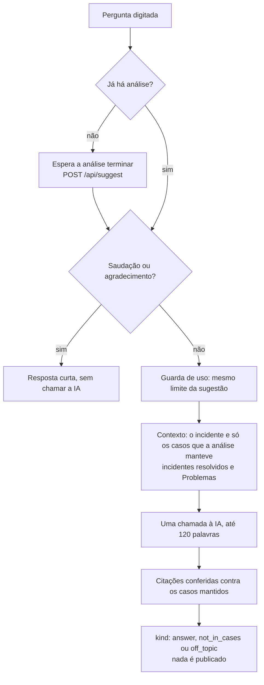

# Fluxo de sugestão (RAG de operação)

Este é o caminho **ao vivo** do demo: dado um incidente, recuperar incidentes
resolvidos e Problemas parecidos, decidir se o chamado é procedente e, se for,
sugerir uma resolução com fontes e publicá-la de volta no incidente. Depois, o
assistente da IA responde perguntas sobre essa análise.

O fluxo reproduz, com dados sintéticos do fictício **Banco Meridiano**, o
pipeline descrito em Ferreira (2026), _Sugestão de resolução de incidentes com
IA_. Os parâmetros públicos dessa referência (cosseno mínimo 0,8, top-K
5 em incidentes e top-K 10 em Problemas) são os padrões da configuração.

O endpoint é `POST /api/suggest`. Cada etapa é uma função pequena e testável em
`backend/src/incident_sense/rag/pipeline.py`, e a resposta expõe todas elas com o
que cada uma decidiu (`steps`, `retrieval`, `decision`, `citations`,
`publication`).

## As sete etapas


Na tela, as etapas aparecem com nomes simples: Carregar, Resumir, Transformar
em números, Buscar e conferir, Classificar, Sugerir e Publicar.

1. **Carregar.** Com `number`, o incidente é lido da base (na referência, do ITSM).
   Categoria, subcategoria, empresa e tags vêm do registro. Sem número, valem os
   campos da requisição e a empresa padrão é `Banco Meridiano`.
2. **Resumo por IA.** O LLM resume o chamado em uma ou duas frases e escolhe tags
   semânticas de um vocabulário fechado. O resumo, e nunca o texto cru, é a
   consulta: a qualidade da sumarização limita todo o pipeline. Se o provedor
   falhar, o título vira a consulta e a etapa aparece como degradada.
3. **Embedding.** O texto vetorizado é o resumo concatenado com
   `Categoria`, `Subcategoria` e `Empresa`, com `openai/text-embedding-3-large`
   (3072 dimensões) via OpenRouter. A resposta devolve esse texto em `query_text`,
   o tamanho do vetor em `dims` e os 24 primeiros valores, arredondados em três
   casas, em `embedding_preview` (para a tela mostrar o texto virando números sem
   trafegar o vetor inteiro).
4. **Recuperação em três camadas** (detalhes abaixo).
5. **Contexto.** Incidentes e Problemas que passaram pelas três camadas formam o
   contexto (`context_ids`).
   **Decisão de procedência** (passo `decidir`, a trava entre a etapa 5 e a 6).
   O LLM decide se o chamado é um incidente técnico (`PROCEDENTE`) ou não
   (`IMPROCEDENTE`: autoatendimento, dúvida, senha). A decisão é sobre o
   chamado, independente da recuperação. Improcedente não gera sugestão;
   procedente sem contexto também não ("sem evidência, a resposta certa é dizer
   que não dá para propor").
6. **Sugestão com fontes.** O LLM escreve a resolução usando só o contexto e cita
   `[INC…]` e `[PRB…]`. O serviço valida cada identificador citado contra o
   contexto recuperado: citação entre colchetes de um id fora do contexto é
   **removida**; menção solta é mantida, marcada no texto como "(fora das
   fontes)" e **sinalizada**. Tudo aparece em `citations.flagged`. Sem nenhuma
   citação válida, o passo diz "A sugestão não cita nenhum caso".
7. **Publicação.** A sugestão validada vira uma nota de trabalho do incidente
   (`publication.note`), lida de volta em `GET /api/incidents/{number}` no campo
   `published_notes`. A nota só cita o que a resposta citou, e só é publicada
   se citar ao menos um caso. O demo não tem ITSM real: as notas ficam em
   memória no processo, **por visitante** (`X-Client-Id`), até 10 por
   incidente, e somem num reinício. A mesma sugestão duas vezes não duplica a
   nota.

## Recuperação em três camadas

| Camada | Pergunta | Como | Na resposta |
| ------ | -------- | ---- | ----------- |
| 1. Tags semânticas | onde procurar? | filtro `MatchAny` em `tags` nas duas coleções | `retrieval.tags` |
| 2. Vetor | o que parece? | cosseno, `RETRIEVAL_MIN_SIMILARITY` (0,8), `INCIDENT_TOP_K` (5), `PROBLEM_TOP_K` (10) | `retrieval.vector` |
| 3. Pós-filtro por LLM | o que serve? | um _node postprocessor_ do LlamaIndex julga incidentes e Problemas numa chamada | `retrieval.postfilter` |

- **Tags.** Ordem de escolha: as tags semânticas do próprio incidente; senão as
  que a IA escolheu no resumo; senão as usuais da categoria e subcategoria na
  base. Tags de bookkeeping (`ruido`, `dados-incompletos`, `demo`...) não fazem
  parte do vocabulário. Sem nenhuma tag, a busca é ampla.
- **Vetor.** Os hits abaixo do limiar continuam na resposta, marcados como
  `passed: false`, para mostrar o que a camada cortou. Na tela, cada caso
  desliza até o seu cosseno numa régua com a linha de 0,80.
- **Pós-filtro.** Cada candidato vai ao juiz numa linha com título, descrição e
  resolução (ou causa raiz, para um Problema), e não só com o título: com o
  título apenas, o juiz descartava os vizinhos mais próximos do incidente da
  aula. Cada caso volta como mantido ou descartado, com o motivo. Se o LLM
  falhar (erro do provedor ou resposta sem avaliações), a lista original volta
  inteira, `status` vira `fallback` com o motivo e a etapa 4 aparece como
  degradada. Degradar a precisão é aceitável; ficar sem resposta, não.

> Buscar por vetor responde "parece". O pós-filtro responde "serve".

## Perguntas ao assistente

O botão **"Perguntar à IA"** abre o assistente da IA no detalhe do incidente.
A primeira pergunta é a análise completa (`POST /api/suggest`), que publica
como descrito acima e é compartilhada com a aba **Análise da IA**. Tudo o que a
pessoa digita depois vai para `POST /api/incidents/{number}/ask`
(`backend/src/incident_sense/api/ask.py`).



- **Pedido:** `{ "question": "...", "context_ids": [...], "model": "..." }`, com
  os `context_ids` da análise. O servidor só aceita como fonte registros reais:
  incidentes resolvidos e Problemas; o próprio incidente nunca é fonte de si
  mesmo.
- **Resposta:** `kind` (`answer`, `not_in_cases` quando os casos não respondem,
  `off_topic` quando a pergunta não é sobre o incidente), `answer`, `citations`
  e os `context_ids` usados de fato.
- Nunca publica nota de trabalho. Saudações ("oi", "obrigado") recebem resposta
  curta sem chamar o modelo nem gastar cota.

Por que só os casos mantidos: a pergunta de acompanhamento herda a mesma regra
da sugestão. Se a resposta pudesse buscar casos novos, a fonte deixaria de ser
conferível na análise que a pessoa acabou de ver. Ver o
[ADR 0021](decisions/0021-pergunta-de-acompanhamento-so-com-casos-mantidos.md).

## Base de Problemas

`backend/data/problems.json` traz 10 registros de **Problema** sintéticos
(`PRB0004101` a `PRB0004110`), um ou dois por arquétipo, cada um com causa raiz,
contorno, solução definitiva, tags e os incidentes que explica
(`linked_incidents`). Eles ficam na coleção `QDRANT_PROBLEMS_COLLECTION`
(`problems`), são buscados com top-K próprio e aparecem na tela **Problemas**
(`GET /api/problems`).

## Vetores da base

A base é vetorizada do mesmo jeito que a consulta, como em Ferreira (2026): resumo +
categoria, subcategoria e empresa.

- `summary_embeddings.npz`: os 326 incidentes resolvidos (resumo + campos).
  Semeia a coleção `incidents_resolved`.
- `problem_embeddings.npz`: os 10 Problemas. Sem ele, cada Problema seria
  indexado na média normalizada dos vetores dos incidentes vinculados (fallback
  determinístico e offline).
- `embeddings.npz`: o texto cru dos 431 incidentes, usado só pelo agrupamento.

Com os vetores do resumo, os incidentes abertos testados tiveram pelo menos 4
similares acima de 0,8, com o melhor entre 0,88 e 0,97. Para regerar (precisa
de chave):

```bash
cd backend
uv run python scripts/reembed.py --incidents --problems
```

Depois de gerar, commite os arquivos e reinicie a API com o Qdrant vazio (ou
`make seed`).

## Por que essas escolhas

### Por que cosseno

Os embeddings representam significado pela **direção** do vetor. A similaridade
de cosseno mede o ângulo entre vetores, então captura "estes textos falam da
mesma coisa" melhor que a distância euclidiana crua.

### Por que um pós-filtro por LLM depois da busca vetorial

A busca vetorial é orientada a **recall**: ela traz tudo que é parecido, e às
vezes traz um incidente que só **compartilha palavras** ("lentidão", "erro") sem
ter a mesma causa. O pós-filtro pede ao LLM uma decisão de relevância por
candidato, removendo esses falsos positivos antes de sugerir.

### Limiar e top-K são configuração

Precisão e cobertura são decisões de produto, não constantes de código. Os
padrões vêm de Ferreira (2026) e podem ser ajustados por variável de ambiente
(`RETRIEVAL_MIN_SIMILARITY`, `INCIDENT_TOP_K`, `PROBLEM_TOP_K`).

### Raciocínio oculto desligado

Todas as chamadas do fluxo pedem `reasoning.enabled=false` à OpenRouter: com
raciocínio ligado, o modelo gastava o `max_tokens` antes de escrever e a
sugestão saía vazia ou cortada. Ver o
[ADR 0022](decisions/0022-raciocinio-oculto-desligado.md).

## Os incidentes da demo

- **Incidente da aula** (`INC0052233`): login no app falhando depois de um
  deploy. É o caso do roteiro e da página Como a IA funciona.
- **PROCEDENTE** (`INC0053082`): Pix debitado sem comprovante. Casa com o
  arquétipo de timeout no Pix e gera sugestão com fontes.
- **Borderline** (`INC0053083`): ambíguo de propósito; mostra o pós-filtro
  trabalhando.
- **IMPROCEDENTE** (`INC0053084`): "esqueci minha senha". Não gera sugestão.

## Na tela

No detalhe do incidente, a aba **Análise da IA** mostra primeiro a resposta
(uma frase, passos numerados, fontes clicáveis, confiança em palavras e o Erro
conhecido no topo quando houver) e depois as sete etapas e a decisão de
procedência, cada uma com o que decidiu. A etapa 4 abre o funil das três
camadas e a régua de similaridade; a etapa 7 leva às **Notas de trabalho**,
onde a sugestão aparece publicada. O assistente da IA (o painel aberto por
"Perguntar à IA") roda o mesmo pipeline e compartilha o resultado com a aba.
No modo aula, as etapas avançam uma a uma, com legenda.

Internamente, alguns identificadores ainda usam o nome antigo do assistente,
"Aurora" (por exemplo `AURORA` em `frontend/lib/model.ts` e a lição
`"aurora"` do modo aula). Na interface o nome é sempre "Assistente da IA".

## Saída didática e modelos trocáveis

A sugestão volta como **markdown simples** (uma frase de diagnóstico + lista
numerada de ações), com tom didático e siglas explicadas na primeira menção. O
frontend renderiza com `react-markdown` + `remark-gfm`; citações `[INC…]` viram
botões que abrem o incidente citado e `[PRB…]` abrem a prévia do Problema.

O **modelo de IA é trocável por requisição**: o seletor do assistente envia um
id público (`frontend/lib/models.ts`) que o backend mapeia para um modelo real
da OpenRouter (`SELECTABLE_MODELS` em `config.py`); ids desconhecidos caem no
padrão.

## Erros e prazos

Cada chamada à OpenRouter desiste em 20 s, sem nova tentativa. Timeout vira
504 ("A IA demorou demais para responder"), falta de cota vira 503 e outras
falhas viram 502, sempre em português. O site desiste em 90 s.

## Testes

Todo o pipeline é testado com LLM, embeddings e Qdrant **falsos** via injeção de
dependência (`backend/tests/test_incident_pipeline.py`, `test_pipeline_audit.py`,
`test_rag.py`, `test_api.py`); as perguntas de acompanhamento em `test_ask.py`;
a indexação de Problemas usa o Qdrant em memória (`test_ingest_memory.py`).
